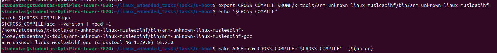
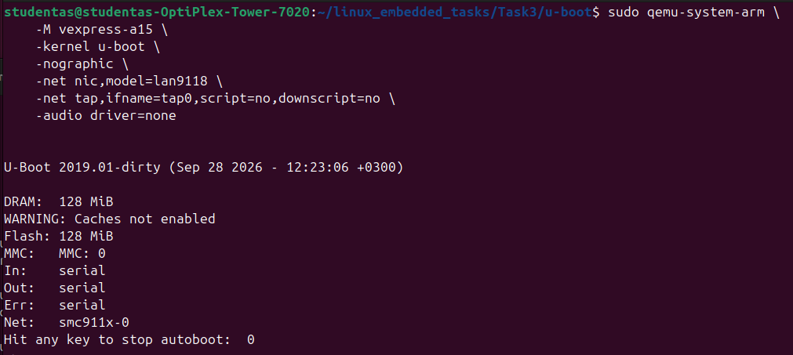
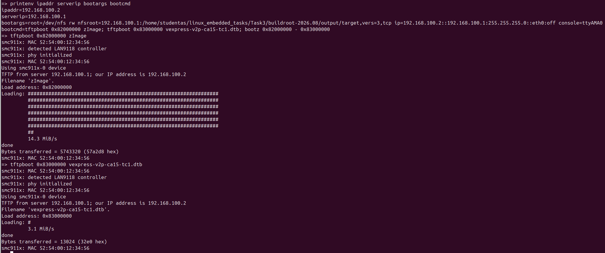
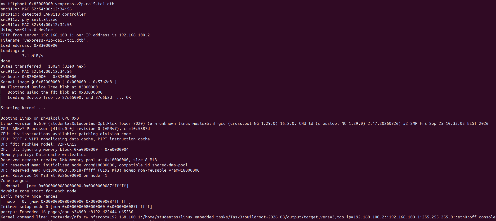
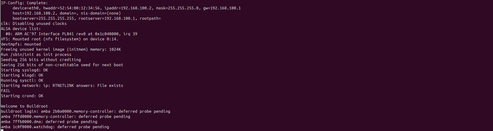
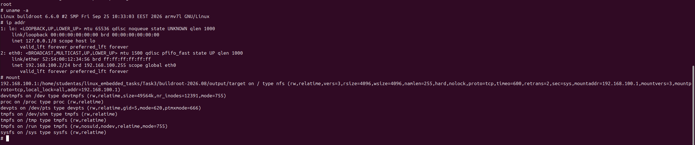

# Custom Embedded Linux Boot Flow on QEMU

A practical embedded Linux project using U-Boot and QEMU to boot an
ARM Cortex-A15 virtual platform, load a Linux kernel over TFTP, and
mount the root filesystem over NFS.

## Project overview

The project demonstrates the boot process of a custom embedded Linux
environment on the QEMU `vexpress-a15` platform.

The boot flow is:

1. Start the ARM virtual platform in QEMU.
2. Initialize U-Boot and inspect its environment variables.
3. Download the Linux kernel (`zImage`) and device tree blob (DTB)
   from a TFTP server.
4. Pass kernel command-line arguments for networking and the NFS root
   filesystem.
5. Boot Linux and reach a working shell.

## Technologies

- U-Boot bootloader
- QEMU ARM virtual platform (`vexpress-a15`)
- Linux kernel
- ARM cross-compilation toolchain
- TFTP for kernel and DTB transfer
- NFS for the root filesystem
- Device Tree

## My work

- Modified the U-Boot configuration for the VExpress CA15 TC2 target.
- Configured U-Boot to use an environment without persistent flash
  storage.
- Adjusted kernel and DTB load addresses for the extended memory map.
- Added default network boot settings for TFTP.
- Configured Linux kernel arguments for network configuration and an
  NFS-mounted root filesystem.
- Built and tested a boot flow that reached a Linux shell in QEMU.

## Repository contents

- `patches/` — reference patches showing the U-Boot configuration
  changes made for this project.
- `screenshots/` — screenshots documenting the boot process.
- `tftp/` — notes about the kernel and DTB files required by the TFTP
  server.

The full U-Boot, Linux kernel, and Buildroot source trees are not
duplicated in this repository.

## Network configuration

The example configuration uses:

- QEMU guest IP: `192.168.100.2`
- Host/server IP: `192.168.100.1`
- TFTP files: `zImage` and `vexpress-v2p-ca15-tc1.dtb`
- Root filesystem: NFS

The NFS export path in the example patch is a placeholder:
`/path/to/buildroot/output/target`

Replace it with the actual exported root filesystem path on the host.
The host's network interface, TFTP service, NFS export, and QEMU network
configuration must match the addresses used by U-Boot and Linux.

## Reproducing the setup

The patches document the configuration changes, but they are not a
complete, self-contained build environment.

To reproduce the setup, you will need compatible U-Boot and Linux
sources, an ARM cross-compilation toolchain, QEMU, a TFTP server, and
an NFS-exported root filesystem.

The exact build and launch commands depend on the source versions and
host configuration used.

## Screenshots

### 1. U-Boot cross-compilation

### 2. QEMU running U-Boot

### 3. U-Boot environment and TFTP downloads

### 4. Linux kernel and cross-compilation toolchain

### 5. Network configuration and NFS root filesystem

### 6. Running Linux shell

## Notes

This project is intended as a learning and portfolio demonstration of
embedded Linux boot configuration and network-based system startup.
